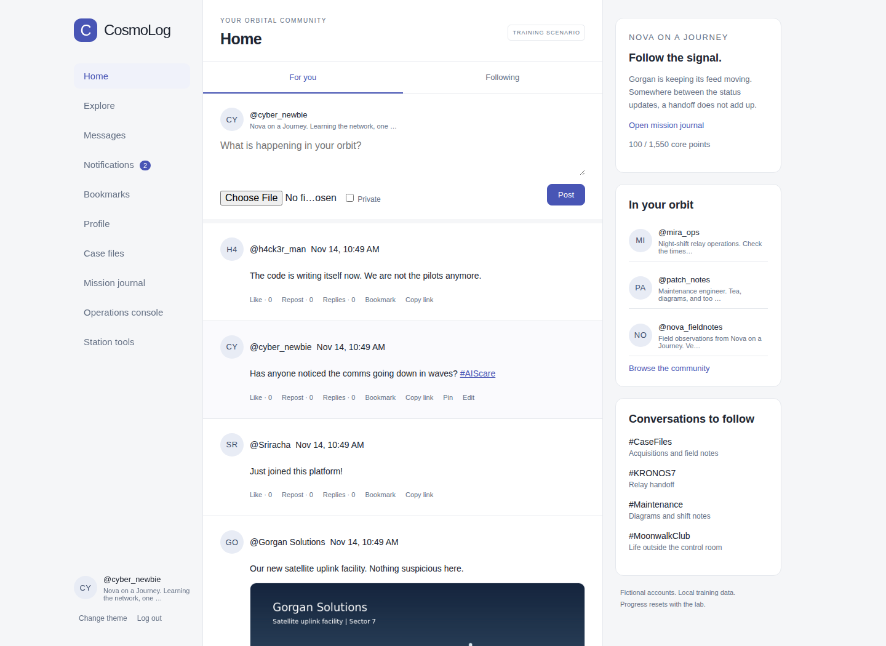
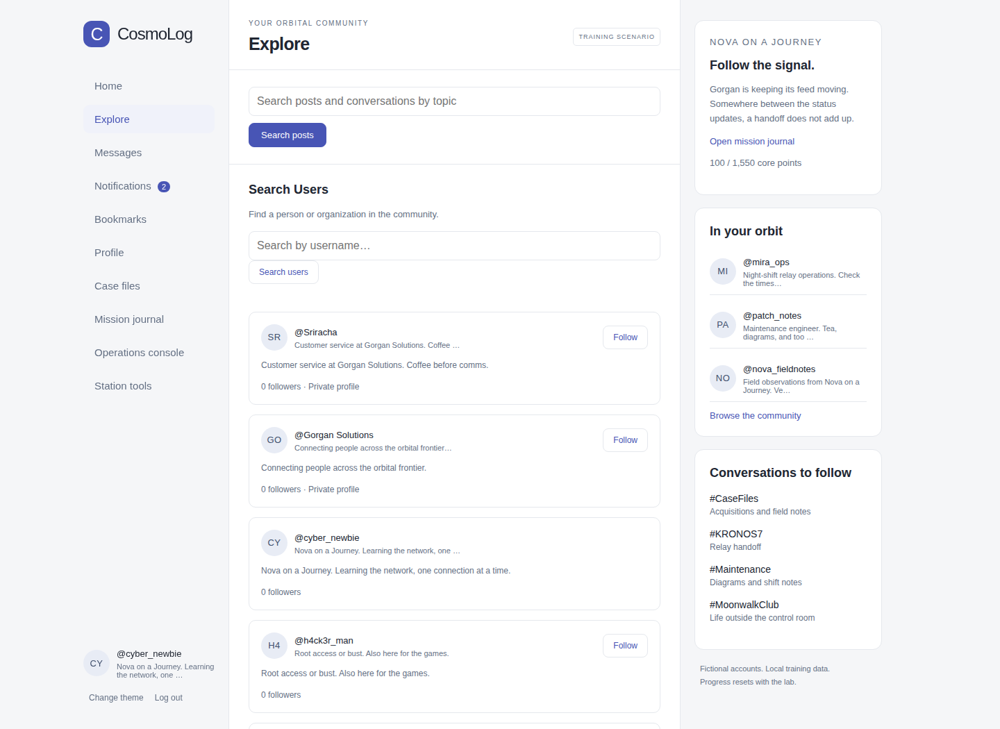
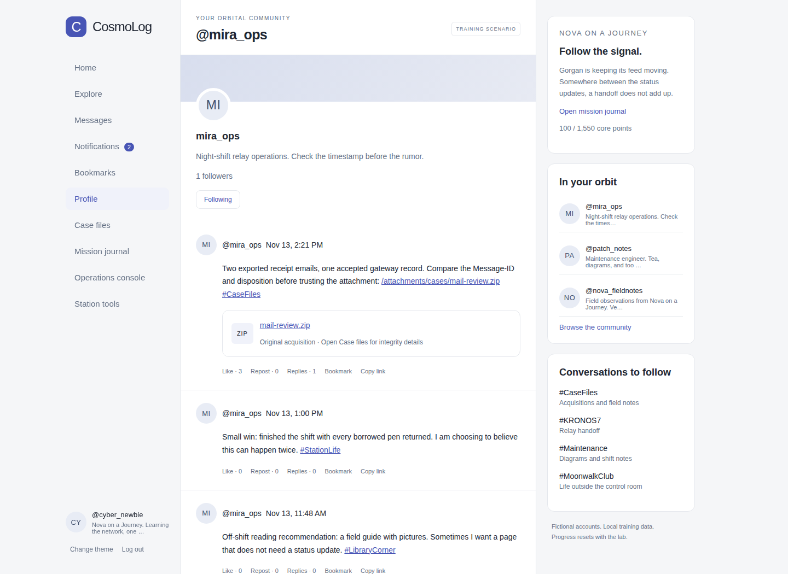
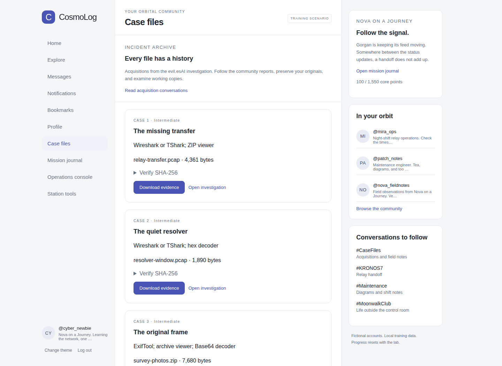
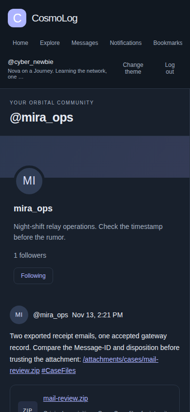
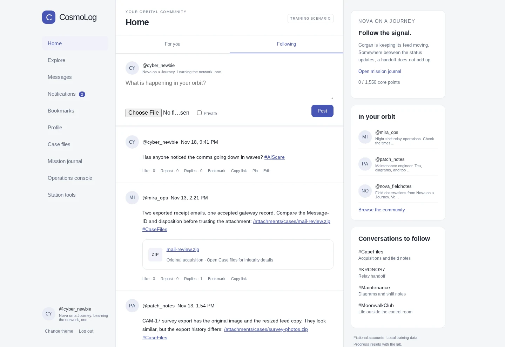
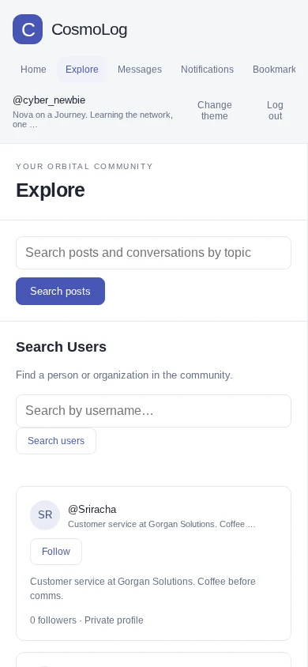

# CosmoLog CTF

CosmoLog is a space-themed capture-the-flag training lab. Follow Nova through a fictional social network, analyze supplied evidence, and submit a final finding in Challenge 15.

[Download ZIP](https://github.com/test3457890/CTFcosmolog/archive/refs/heads/main.zip) · [Setup guide](docs/Setup.md) · [VM guide](docs/Virtual%20Machine.md) · [Wiki](https://github.com/test3457890/CTFcosmolog/wiki) · [Documentation hub](docs/README.md) · [Get help](https://github.com/test3457890/CTFcosmolog/discussions/1)

## Screenshots

[View all 9 screenshots](docs/screenshots/README.md).

These previews show the running CosmoLog app. Start in the social feed, explore community profiles, and download original evidence from Case files.

| Social feed | Community search |
|---|---|
| [](docs/screenshots/Feed.png) | [](docs/screenshots/Explore.png) |

| Public profile | Evidence downloads |
|---|---|
| [](docs/screenshots/Profile.png) | [](docs/screenshots/Evidence.png) |

Click a preview to view it at full resolution.

<details>
<summary>Mobile preview in dark mode</summary>



</details>

| Following feed | Community search on a phone-width screen |
| --- | --- |
| [](docs/screenshots/following-feed.webp) | [](docs/screenshots/phone-explore.webp) |

## Download and start

> The lab is intentionally vulnerable. The default Compose configuration binds port 3000 to `127.0.0.1` on the VM. Run it only in an isolated training environment; for approved multi-machine events, bind a specific private VM interface as described in the [VM guide](docs/Virtual%20Machine.md). Never forward the lab to the internet.

Inside your prepared Linux VM, with Docker and `docker-compose` installed:

```sh
git clone https://github.com/test3457890/CTFcosmolog.git
cd CTFcosmolog
touch database.sqlite
docker-compose up -d
```

Alternatively, download the ZIP above, extract it, and open a terminal in the extracted folder, usually `CTFcosmolog-main`. Then run the same two startup commands. If access is restricted, sign in to an authorized GitHub account first. Do not put a GitHub token in a clone URL or shared command.

Open http://localhost:3000 in the VM browser.

| Login purpose | Username | Password or access method |
|---|---|---|
| Student app account | `cyber_newbie` | `password123` |
| Alternative app account | `h4ck3r_man` | `password123` |
| Staff document vault | No username | Separate organizer Unlock Key file; never an app password |
| Linux VM login | Chosen during VM preparation | Set by the VM organizer; not a CosmoLog account |

New to Docker or using Kali/Parrot? Start with the [step-by-step setup guide](docs/Setup.md). To distribute a prepared VM, use the [VM preparation and handoff guide](docs/Virtual%20Machine.md).

## Recommended environment

Use Parrot Security OS with Docker as the primary lab environment. Kali Linux with Docker is the alternative. Install and verify the analysis tools in the VM before handing it to students.

| Use | Recommendation | Verification |
|---|---|---|
| Primary student/practice setup | Parrot Security OS VM in VirtualBox, with CosmoLog in Docker | Preinstall the browser and required forensic tools; verify your chosen VM image |
| Alternative student/practice setup | Kali Linux VM in VirtualBox, with CosmoLog in Docker | Preinstall and verify the same analysis tools |
| Scored-event layout | Organizer-controlled Parrot/Kali Docker target and separate Parrot/Kali student analysis VMs | Keep source and target administration with the organizer |
| Windows host | Run the Linux VM in VirtualBox | A Windows-native app installation is not required |

Parrot Security OS is the primary recommendation. Kali Linux is the alternative. The app's Node dependencies run inside Docker; Wireshark and other desktop analysis tools run in the VM. VirtualBox and Docker can be used together.

A self-contained practice VM is convenient, but giving someone VM administrator or Docker access also exposes the challenge source and answers. For a scored event, keep the target VM under organizer control and give competitors a separate analysis VM plus the app URL. See the VM guide for both layouts.

## Challenge tracks

| Track | Challenges | Result |
|---|---|---|
| Web investigation | 1–7 | Original seven challenges; 1,550 total points |
| Offline forensics | 8–14 | Seven tool-based cases; separate completion |
| Operations capstone | 15 | Final source/evidence/replay review; separate completion |
| Side stories | Four additional entries | Optional, unscored investigation paths |

There are 15 numbered challenges and four side-story entries, for 19 journal entries. Original flags and scoring are preserved. Starting the server resets social progress and capstone checkpoints; uploaded files persist. Shared accounts share progress. Use independent lab instances for independent teams.

## What students see

- A responsive community feed with 12 fictional profiles, 92 additional story posts, and 39 seeded replies.
- Likes, reposts, follows, bookmarks, threaded replies, profile pages, notifications, and six ordinary inbox conversations per student account.
- Social post images are limited to 10 MB each; oversized uploads return an error and are not saved.
- Age-appropriate, politically neutral station life alongside incident reports and explainable false leads.
- Case files with original downloads, byte counts, and SHA-256 hashes.
- A filtered Mission journal with progressive hints and duplicate-submission protection.
- An Operations console with searchable source snapshots, request replay, evidence history, and a final finding.
- Light/dark themes and desktop/mobile layouts.

## Analysis tools

Prepare these in the Parrot/Kali VM before distribution so students can begin investigating immediately. A security distribution may include many tools already; verify each required one rather than assuming every image ships the same packages.

Steghide for the original JPEG challenge, Wireshark or TShark, ExifTool, DB Browser for SQLite or sqlite3, Autopsy or The Sleuth Kit, an archive viewer, and a text editor or timeline tool support the forensic sequence. Students inspect supplied fictional captures and records; live network capture is not required. Analysis tools are installed separately from the app.

## Documentation and access

[Player Guide](Guides/Player%20Guide.md) contains navigation and evidence-handling instructions without staff answers.

The full Word Setup and Learning Guide, Hint Book, Staff Guide, and solution-bearing technical reference are distributed separately in an encrypted offline staff vault. They are intentionally absent from this checkout and the application image. Keep the vault, unlock key, decrypted ZIP, and extracted documents off the lab host and outside participant materials. No staff-document password is stored in CosmoLog.

Source, tests, evidence builders, previous commits, and workflow artifacts can reveal answers. Removing current guide files does not remove earlier public copies. Restrict repository visibility and access before an event; a public source repository cannot conceal its challenge answers. The current source distribution is organizer material, not a competitor bundle.

[Documentation handling](DOCUMENTATION.md) explains the separation and remaining exposure. [Change log](CHANGELOG.md) summarizes the current release without reproducing solutions.

## Validation

The repository has regression, forensic evidence, and Docker/browser validation workflows. These cover the existing web challenges, all seven offline evidence cases, capstone replay/report behavior, scoring, resets, downloads, and desktop/mobile flows. Run event-host readiness checks from the private staff runbook before participants begin. Keep screenshots and logs staff-only.

The automated Docker/browser workflows use Ubuntu 24.04 runners. That CI implementation detail does not change the recommended Parrot/Kali student environment. A prepared Parrot/Kali VM image has not been built or certified by CI.

The Docker build and Node regression workflow install the exact production dependency tree recorded in `package-lock.json` with `npm ci`. The maintained Node runtime is version 22, and `sqlite3` 6.0.1 replaces the older native dependency chain. The Node workflow checks production dependency advisories at build time. An audit result is a point-in-time check and does not make this intentionally vulnerable CTF safe to publish on the internet.

For the owner's planned Windows host and Linux VM session, follow the [manual test checklist](docs/Owner%20Test%20Checklist.md). Its boxes remain pending until tested on that environment.
